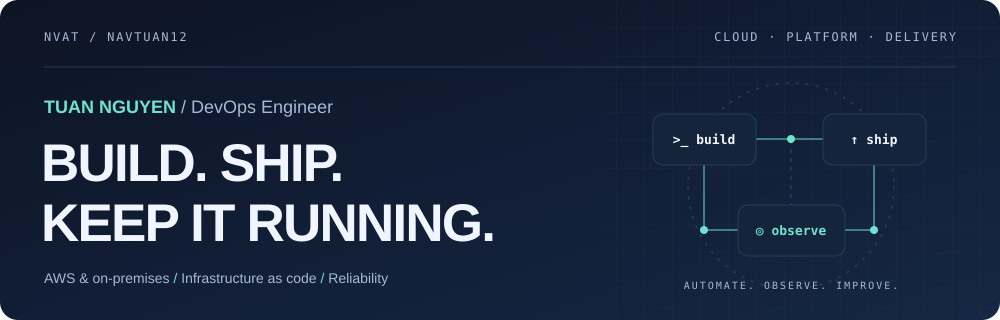

<picture>
  <source media="(prefers-color-scheme: dark)" srcset="assets/banner-dark.svg">
  <source media="(prefers-color-scheme: light)" srcset="assets/banner-light.svg">
  
</picture>

# Hi, I'm Tuan 👋

**Nguyen Van Anh Tuan · DevOps Engineer · Ho Chi Minh City, Vietnam**

I build and operate cloud-native infrastructure across **AWS and on-premises environments**. My work connects infrastructure as code, Kubernetes, delivery automation, observability, and security to make platforms easier to ship and run.

[Email](mailto:anhtuan.mmt@gmail.com) · [Explore my repositories](https://github.com/navtuan12?tab=repositories) · [Read my thesis](https://ir.vnulib.edu.vn/handle/VNUHCM/37249)

### What I work on

- **Cloud automation** — event-driven AWS workflows, reusable infrastructure, and automated compute lifecycles.
- **Platform engineering** — highly available Kubernetes, GitOps, distributed storage, and hybrid infrastructure.
- **Reliable delivery** — CI/CD, OpenTelemetry, the LGTM stack, and troubleshooting production systems.
- **DevSecOps** — SAST, SCA, DAST, secrets management, and security gates in delivery pipelines.

### Toolbox

<picture>
  <source media="(prefers-color-scheme: dark)" srcset="assets/skills-dark.svg">
  <source media="(prefers-color-scheme: light)" srcset="assets/skills-light.svg">
  
</picture>

### Beyond the code

<picture>
  <source media="(prefers-color-scheme: dark)" srcset="assets/metrics-dark.svg">
  <source media="(prefers-color-scheme: light)" srcset="assets/metrics-light.svg">
  
</picture>

<b>Education, research & achievements</b>

- **B.Sc. in Computer Networks and Communications** — University of Information Technology, VNU-HCM. GPA: **8.12/10**.
- **Bachelor's thesis:** Applying Large Language Models for E-Commerce Search and Recommendation. Evaluated query enhancement with the BEIR framework and Amazon ESCI dataset.
- **TOEIC (2025):** Listening & Reading **860/990** · Speaking & Writing **280/400**.
- **2nd place, NetChallenge Competition (2023).**

---

*“Discipline outlasts motivation.”*

Technology icons by <a href="https://github.com/tandpfun/skill-icons">Skill Icons</a> · GitHub visuals by <a href="https://github.com/lowlighter/metrics">Metrics</a>.
